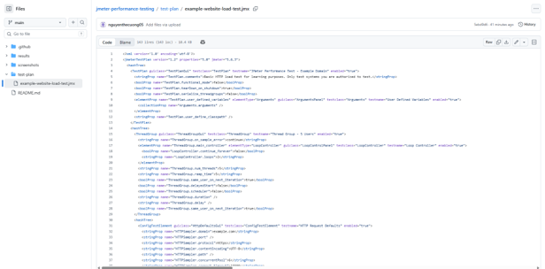
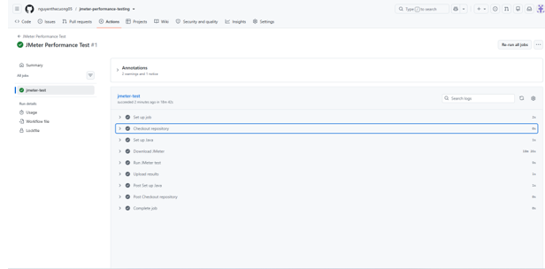
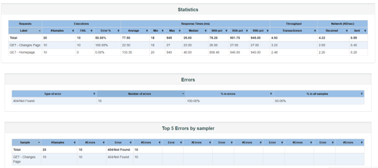
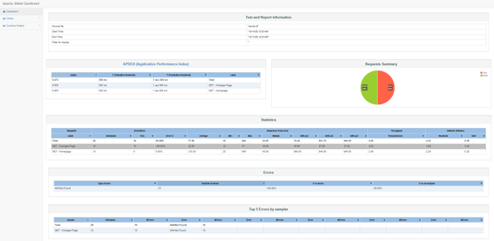

# Báo cáo kiểm thử hiệu năng website bằng Apache JMeter

> **Sinh viên:** Nguyễn Thế Cường 
> **Mã sinh viên:** 23010176  
> **Môn học/lớp:** Đánh giá và kiểm thử chất lượng phần mềm 
> **Ngày thực hiện:** 14/10/2026

## 1. Giới thiệu

Đề tài thực hiện kiểm thử hiệu năng cơ bản cho website bằng Apache JMeter. Bài kiểm thử gửi các HTTP GET request đến website mẫu `https://example.com`, kiểm tra mã phản hồi HTTP và thu thập các chỉ số thời gian phản hồi.

Do máy tính tại trường không có quyền cài đặt phần mềm, Apache JMeter được tải và chạy trên GitHub Actions. Cách làm này không yêu cầu cài JMeter trực tiếp trên máy tính cá nhân.

## 2. Mục tiêu

- Tìm hiểu Test Plan và Thread Group trong JMeter.
- Mô phỏng nhiều người dùng gửi yêu cầu HTTP đến website.
- Kiểm tra mã phản hồi HTTP bằng Response Assertion.
- Thu thập và xem các chỉ số như tổng số request, thời gian phản hồi và tỷ lệ lỗi.
- Lưu Test Plan, báo cáo và ảnh minh chứng trên GitHub.

## 3. Công cụ sử dụng

- Apache JMeter 5.6.3.
- Java 17 trên GitHub Actions runner.
- GitHub repository và GitHub Actions để chạy kiểm thử, lưu kết quả.

## 4. Kịch bản kiểm thử

| Thuộc tính | Giá trị |
|---|---|
| Website kiểm thử | `https://example.com` |
| Số người dùng ảo (Threads) | 5 |
| Ramp-up period | 5 giây |
| Loop count | 2 |
| Request 1 | `GET /` |
| Request 2 | `GET /changes.html` |
| Điều kiện kiểm tra | Mã phản hồi HTTP bằng 200 |
| Tổng số mẫu dự kiến | 20 (5 người dùng × 2 request × 2 vòng lặp) |

**Lưu ý:** 20 là số mẫu dự kiến nếu mọi request đều được thực hiện. Hãy ghi số liệu đo được từ lần chạy thực tế ở mục 7, không coi số dự kiến là kết quả.

## 5. Cấu trúc repository

- `test-plan/example-website-load-test.jmx`: kịch bản kiểm thử JMeter.
- `.github/workflows/jmeter-test.yml`: cấu hình GitHub Actions tải JMeter và chạy bài kiểm thử.
- `results/`: ghi chú hoặc kết quả kiểm thử được lưu trong repository (nếu có).
- `screenshots/`: ảnh minh chứng do sinh viên chụp từ lần chạy thực tế.

## 6. Cách thực hiện

1. Mở repository trên GitHub và chọn tab **Actions**.
2. Chọn workflow **JMeter Performance Test**.
3. Chạy workflow bằng **Run workflow** (nếu chưa tự chạy).
4. Mở lần chạy mới nhất và kiểm tra trạng thái. Dấu tích xanh cho biết job hoàn thành thành công; vẫn cần kiểm tra kết quả JMeter và assertion.
5. Tải artifact `jmeter-results` ở phần **Artifacts** của trang Summary.
6. Giải nén artifact để xem file kết quả `.jtl` và báo cáo HTML nếu workflow đã tạo ra chúng.
7. Chụp ảnh màn hình thật và upload vào thư mục `screenshots/`.

## 7. Kết quả kiểm thử thực tế

**Điền các giá trị dưới đây từ artifact/báo cáo của lần chạy thành công. Không để nguyên dấu ngoặc vuông khi nộp và không tự đặt số liệu.**

| Chỉ số | Kết quả thực tế |
|---|---|
| Tổng số mẫu (Samples) | [20] |
| Thời gian phản hồi trung bình (Average, ms) | [77,90 ms] |
| Thời gian phản hồi nhỏ nhất (Min, ms) | [18 ms] |
| Thời gian phản hồi lớn nhất (Max, ms) | [945 ms] |
| Throughput | [4,93 giao dịch/giây] |
| Tỷ lệ lỗi (Error %) | [50%] |
| Kết quả assertion | [10 mẫu thành công, 10 mẫu thất bại] |

### Nhận xét

[Nhận xét dựa trên số liệu thực tế: số request hoàn thành, mã HTTP trả về, assertion có đạt không, thời gian phản hồi và tỷ lệ lỗi. Đây là bài thử nghiệm nhỏ trên website mẫu, không đại diện cho khả năng chịu tải của website sản xuất.]

## 8. Ảnh minh chứng

Upload ảnh vào thư mục `screenshots/` của repository. Tên file và đường dẫn trong Markdown phải khớp chính xác thì ảnh mới hiển thị.

### 8.1. Kịch bản kiểm thử

Ảnh chụp phần cấu hình trong file `.jmx` trên GitHub, hoặc ảnh giao diện JMeter nếu có thể mở Test Plan bằng JMeter.

### 8.2. GitHub Actions chạy thành công

Ảnh chụp trang chi tiết workflow có dấu tích xanh và các bước `Download JMeter`, `Run JMeter test`, `Upload results` hoàn thành.

### 8.3. Báo cáo tổng hợp

Ảnh chụp bảng số liệu thực tế trong HTML dashboard hoặc Summary/Aggregate Report được tạo bởi JMeter.

### 8.4. Báo cáo HTML

Nếu artifact có HTML dashboard, mở file `index.html` trong báo cáo đã giải nén rồi chụp ảnh phần dashboard hiển thị các chỉ số thực tế.

> Các đường dẫn ảnh ở trên là vị trí dự kiến. Ảnh chỉ hiển thị sau khi file ảnh thật được upload vào đúng thư mục `screenshots/` và được commit lên GitHub. Không tạo ảnh giả hoặc tự điền số liệu chưa đo.

## 9. Kết luận

Bài thực hành giúp làm quen với việc xây dựng kịch bản JMeter, mô phỏng người dùng, kiểm tra mã phản hồi HTTP và thu thập số liệu hiệu năng. Kết luận cuối cùng cần dựa trên kết quả thực tế trong artifact của lần chạy.

## 10. Tài liệu tham khảo

- Apache JMeter: https://jmeter.apache.org/
- Getting Started: https://jmeter.apache.org/usermanual/get-started.html
- Building a Web Test Plan: https://jmeter.apache.org/usermanual/build-web-test-plan
